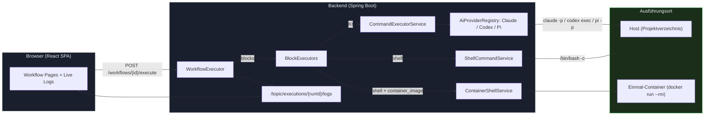
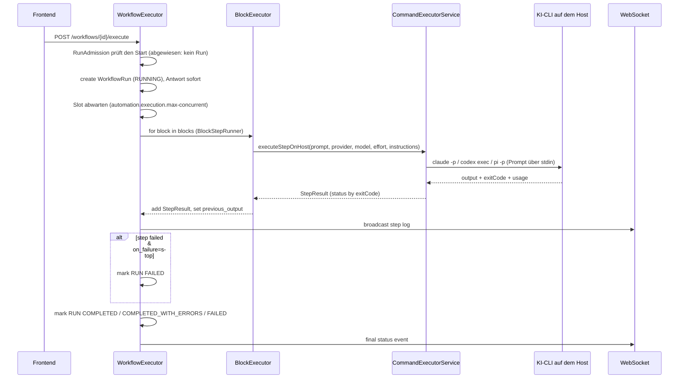
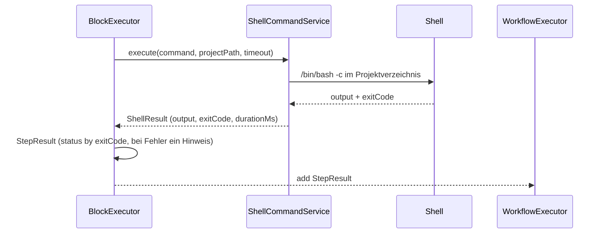
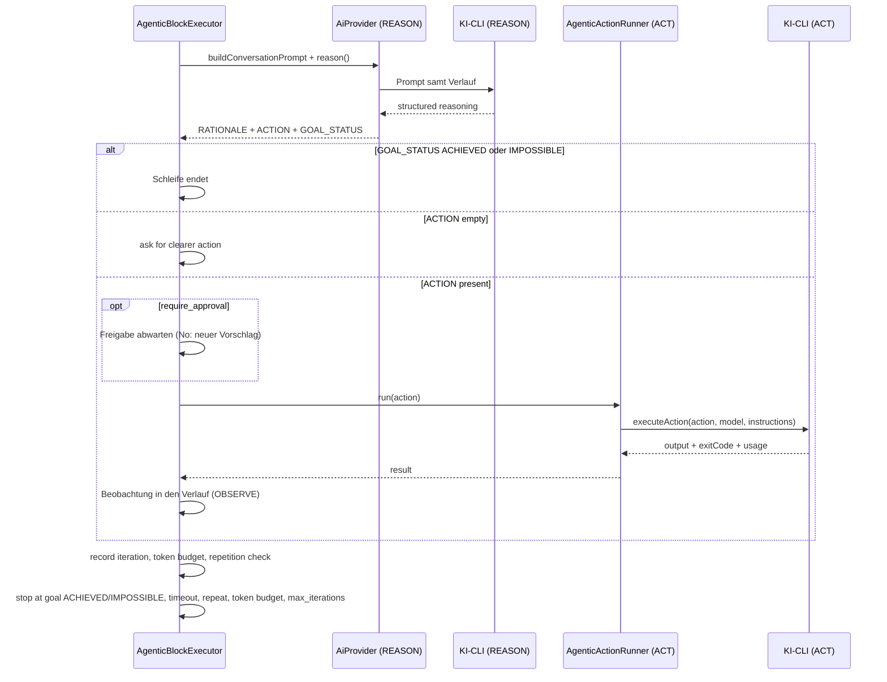
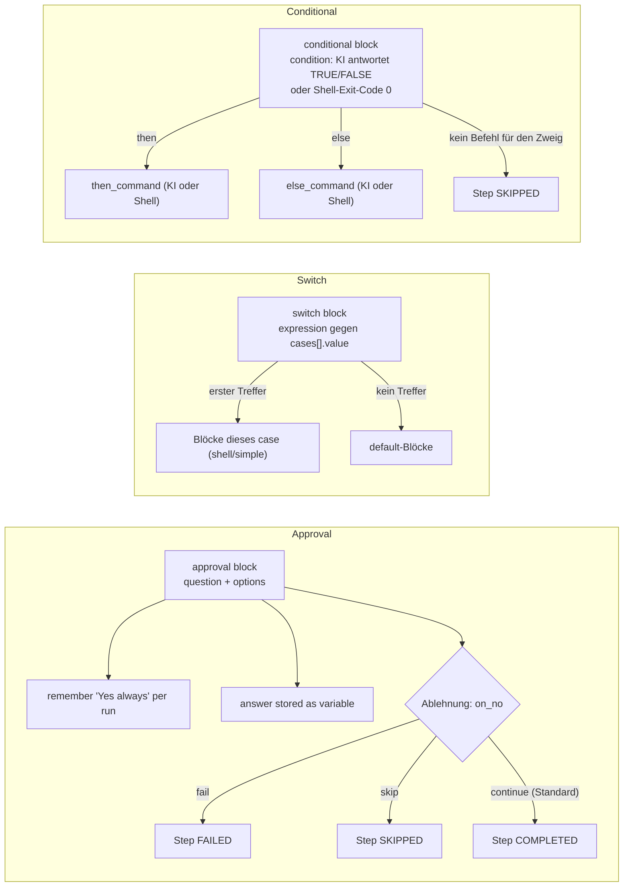

# MySuricates — Workflow Engine

Kernlogik, Ausführungsmodi (mit/ohne KI) und Steuerflüsse

## Systemübersicht — *High-Level*

Alle Workflows laufen über den `WorkflowExecutor`: Er lässt den Start von `RunAdmission` prüfen, legt den Run an und arbeitet die Blöcke auf einem virtuellen Thread ab. KI-Blöcke rufen über den `CommandExecutorService` die CLI des gewählten Anbieters auf dem Host auf, Shell-Blöcke laufen auf dem Host oder mit `container_image` in einem Einmal-Container. Logs gehen per WebSocket an die Oberfläche.



## Ausführung (Standard, KI-gestützt) — *KI-Block*

Ein KI-Block (etwa `simple`) schickt seinen Prompt über `CommandExecutorService.executeStepOnHost` an den Anbieter aus Block oder Workflow, sonst an den Systemstandard; Modell und Effort folgen derselben Rangfolge. Die Anweisungen (Basis aus `agent-instructions.md` plus Workflow-Anweisungen) gehen als System-Prompt mit.



## Ausführung (ohne KI) — *Shell-Pfade*

Der Shell-Modus nutzt weder Modelle noch Anweisungen und bewertet nur den Exit-Code.



### Wann Shell?

- Blocktyp `shell`
- `execution_mode: shell` bei foreach, while, retry und conditional sowie bei Blöcken in switch-cases
- `container_image` am Shell-Befehl: derselbe Weg, aber in einem Einmal-Container

### Unterschiede

- Kein Modell, keine Tokens
- Deterministisch durch Exit-Code; nach `timeout_seconds` (Standard 300) Exit-Code 124
- Metadaten: `exitCode`, `executionMode` (`shell` oder `container:<image>`)

## Agentic Loop — *Reason–Act–Observe*

Mehrstufige KI-Planung mit Token- und Zeitbudgets, Wiederholungs-Stopp und optionaler Freigabe. Beide Phasen laufen über den Anbieter aus Block oder Workflow; bei Claude geht REASON mit `--system-prompt` und `--max-turns 3`, ACT mit `--append-system-prompt` an die CLI.



## Control Flow — *Conditional, Switch & Approval*

Verzweigungen und Freigaben innerhalb eines Runs.



## Provider & Ausführungsmodi — *KI vs. ohne KI*

| Merkmal | KI (Claude, Codex, Pi) | Ohne KI (Shell) |
|---|---|---|
| CLI | `claude -p`, `codex exec`, `pi -p` | `/bin/bash -c` |
| Anbieter | `provider` am Block > am Workflow > Systemstandard | — |
| Kontext | Anweisungen als System-Prompt, `.claude/rules/` (Skills, Memory, Projektkontext), `{{ previous_output }}` | Nur der Befehl mit aufgelösten Platzhaltern |
| Determinismus | Niedriger (LLM) | Hoch (Exit-Code) |
| Telemetrie | Tokens, Kosten, Modell in `StepResult.metadata` (`aiRequest`) | `exitCode`, `executionMode`, Dauer |
| Ort | Host, Projektverzeichnis | Host, Projektverzeichnis; mit `container_image` ein Einmal-Container |

## Block-Matrix — *Typ → Exec-Modus*

Ein Schritt mit Status FAILED beendet den Run, solange `on_failure` nicht `"continue"` ist.

| Block | Standard | Optionen (Auswahl) | Schritt FAILED, wenn … |
|---|---|---|---|
| `simple` | KI | `timeout_seconds`, `provider`, `model`, `effort` | die KI-CLI mit Fehler endet |
| `shell` | Shell | `timeout_seconds`, `container_image`, `checked_command`, `shell_escape_variables` | der Exit-Code nicht 0 ist |
| `retry` | KI | `execution_mode`=ai/shell, `max_retries`, `delay`, `exponential_backoff`, `timeout_seconds` | alle Versuche scheitern |
| `foreach` | KI | `execution_mode`=ai/shell, `items_source`=list/command, `continue_on_error`, `max_consecutive_failures`, `timeout_seconds`, `workflow_id` + `context` (je Item ein Kind-Lauf statt Befehl) | ein Item scheitert (außer mit `continue_on_error`); `max_consecutive_failures` Items in Folge scheitern (Standard 3, auch mit `continue_on_error`); mit `workflow_id`: ein Kind-Lauf endet nicht `COMPLETED` |
| `while` | KI | `execution_mode`=ai/shell, `condition_command`, `max_iterations`, `timeout_seconds` | eine Iteration scheitert |
| `conditional` | KI | `execution_mode`=ai/shell, `then_command`, `else_command`, `timeout_seconds` | der gewählte Befehl scheitert |
| `switch` | – | `expression`, `cases`, `default` | ein Block im gewählten case scheitert |
| `approval` | – | `mode`=ask/auto, `on_no`=continue/skip/fail, `timeout_minutes` | abgelehnt mit `on_no: fail`, Timeout oder Abbruch |
| `human-input` | – | `input_type`, `fields`, `timeout_minutes` | Timeout ohne Standardwert |
| `skill-capability` | KI | `capability`, `params`, `input`, `allow_writes`, `timeout_seconds` | eine schreibende Capability ohne `allow_writes` läuft oder der Aufruf scheitert |
| `sub-workflow` | wie der Kind-Workflow | `workflow_id`; Tiefe ≤ 5, wartet höchstens 30 min | der Kind-Run nicht COMPLETED endet, Zyklus, Timeout |
| `agentic` | KI | Budget, Iterationen, `require_approval`, `timeout_seconds` | das Ziel nicht erreicht ist |

Ohne KI und ohne Shell arbeiten `integration`, `document`, `todo-create`, `todo-update`, `todo-close`, `compress` und `dashboard-report`; `compress-ai` ist ein einzelner Claude-Aufruf ohne Werkzeuge. Die vollständigen Schlüssel je Typ stehen im [WORKFLOW-GUIDE.md](WORKFLOW-GUIDE.md).

## Konfiguration — *application.yml (relevant)*

### Execution Limits

`automation.execution.max-concurrent`: parallele Runs (Standard 10)

`automation.host-claude.timeout-seconds`: Timeout eines Claude-CLI-Aufrufs (Standard 300); je Block gilt `timeout_seconds`

`automation.host-claude.max-concurrent-calls` und `reserved-for-interactive`: gleichzeitige Claude-Aufrufe (5, davon 1 für den Chat frei); ebenso `automation.host-pi.*` für pi und `automation.ai-cli.codex-*` für Codex, dazu `automation.ai-cli.max-concurrent-calls` über alle KI-CLIs zusammen (8, davon 1 frei). Alle Werte lassen sich zur Laufzeit in den Einstellungen ändern

`docker.container.idle-timeout-minutes`: Projekt-Container im Leerlauf stoppen

### Security

`automation.security.enabled` / `api-key`

`automation.security.rate-limit.*`: standardmäßig an, 120 Anfragen pro Minute

CORS: `automation.cors.allowed-origins`

## Dateistruktur — *Kernklassen*

```text
ai-automation-backend/src/main/java/com/automation/
├── executor/
│   ├── ExecutionContext.java
│   ├── BlockExecutor.java
│   └── blocks/            (*BlockExecutor per block type + helpers)
├── service/workflow/
│   ├── WorkflowExecutor.java
│   ├── RunAdmission.java
│   ├── BlockStepRunner.java
│   ├── ExecutionContextFactory.java
│   ├── ExecutionBroadcaster.java
│   ├── RunCompletionHandler.java
│   └── AgentInstructionsService.java
├── service/cli/
│   ├── CommandExecutorService.java
│   ├── ShellCommandService.java
│   └── ContainerShellService.java
└── service/ai/
    ├── AiProviderRegistry.java
    ├── HostClaudeService.java
    ├── HostCodexService.java
    └── HostPiService.java
```
