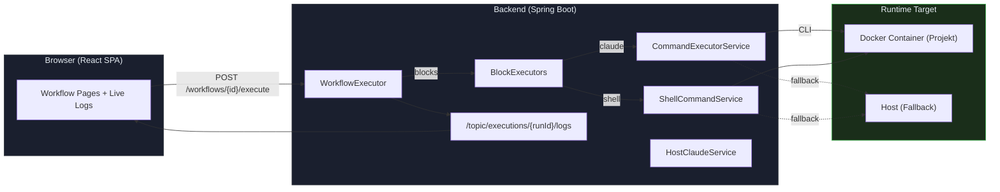
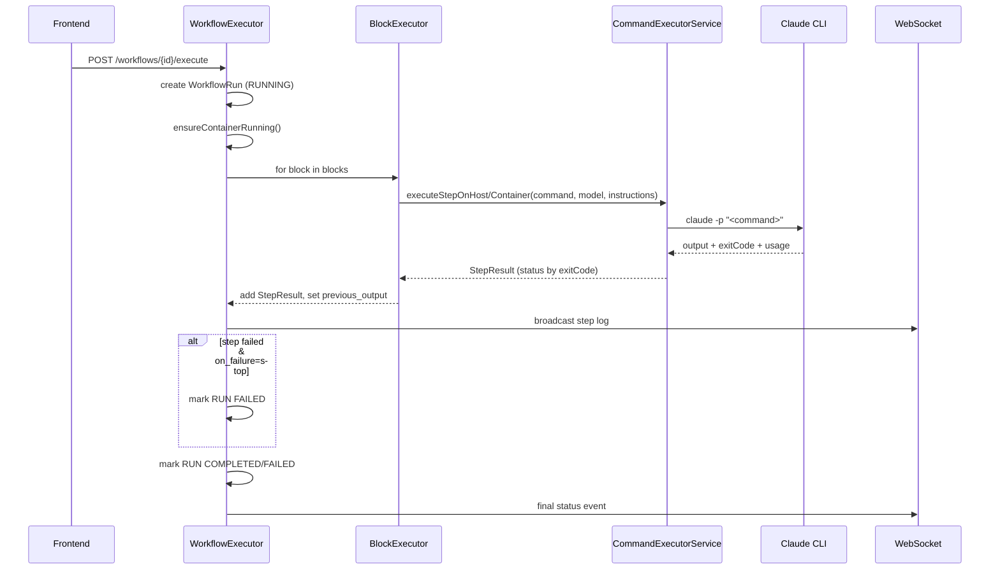
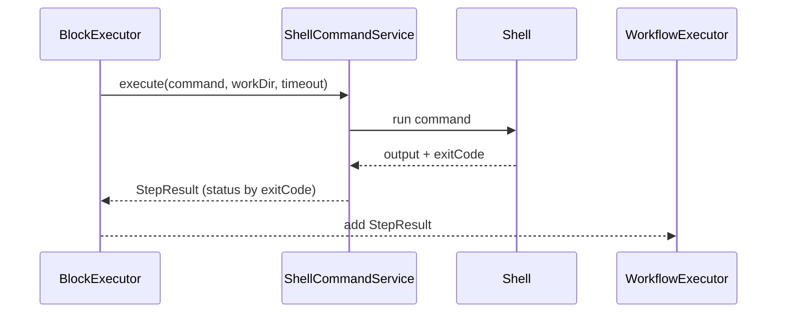
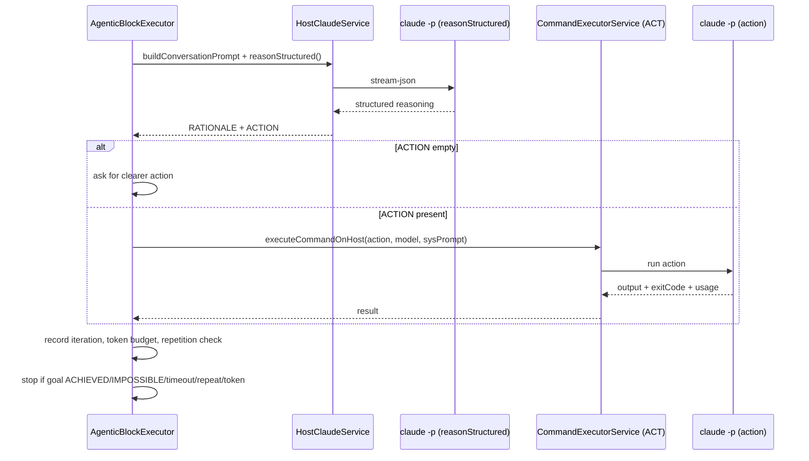
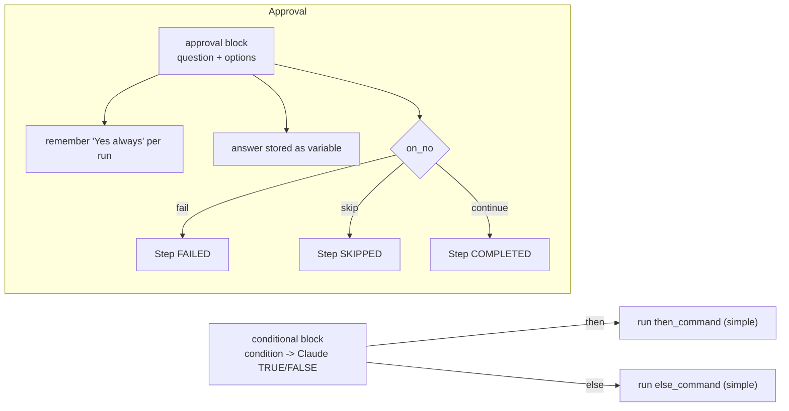

# AutoPilot — Workflow Engine

Kernlogik, Ausführungsmodi (mit/ohne KI) und Steuerflüsse

## Systemuebersicht — *High-Level*

Alle Workflows laufen ueber den WorkflowExecutor. Er orchestriert BlockExecutors, Container-Start, Skill-Kontext und WebSocket-Logs.



## Ausfuehrung (Standard, KI-gestuetzt) — *Reason/Act*

Default: Befehle gehen an Claude-CLI (Host/Container). Instruction-Prefix + Model kommen aus dem Workflow.



## Ausfuehrung (ohne KI) — *Shell-Pfade*

Shell-Mode nutzt keine Modelle, keine Instruktions-Prefixe, bewertet nur Exit-Code.



### Wann Shell?

- Blocktyp `shell`
- `execution_mode=shell` bei foreach/while/retry

### Unterschiede

- Kein Model / kein Prompt-Limit
- Deterministisch durch Exit-Code
- Kein Token-Metadata

## Agentic Loop — *Reason–Act–Observe*

Mehrstufige KI-Planung mit Token-/Zeit-Budgets, Wiederholungs-Stopp und optionalem Approval.



## Control Flow — *Conditional & Approval*

Branching und User-Gates innerhalb eines Runs.



## Provider & Ausfuehrungsmodi — *KI vs. Kein KI*

| Merkmal | KI (Claude) | Ohne KI (Shell) |
|---|---|---|
| CLI | `claude -p` | System-Shell |
| Kontext | Instruction-Prefix, Skill-Context, previous_output | Nur Shell-Kommandostring |
| Determinismus | Niedriger (LLM) | Hoch (Exit-Code) |
| Telemetry | Token/Cost in StepResult.metadata | exitCode + duration |
| Fallback | Host, falls Container nicht startet | Host gleicher Pfad |

## Block-Matrix — *Typ → Exec-Modus*

| Block | Default | Optionen | Stop on failure |
|---|---|---|---|
| `simple` | claude | `timeout_seconds` | Ja (default) |
| `shell` | shell | `timeout_seconds` | Ja |
| `retry` | claude | `execution_mode`=shell/ai, `max_retries`, `delay`, `exponential_backoff`, `timeout_seconds` | Ja (wenn alle Fehlversuche) |
| `foreach` | claude | `execution_mode`=shell, `items_source`=list/command, `timeout_seconds` | Aggregiertes Ergebnis |
| `while` | claude | `execution_mode`=shell, `condition_command`, `timeout_seconds` | Ja bei innerem Fail |
| `conditional` | claude | `timeout_seconds` | Branch-spezifisch |
| `approval` | - | `mode`=ask/auto, `on_no`=fail/skip/continue | on_no=fail |
| `skill-capability` | claude | `params`, `input`, `timeout_seconds` | Ja |
| `sub-workflow` | depends | Tiefe<=5, Timeout 30 min | Ja bei Timeout/Zyklus |
| `agentic` | claude | Budget, Iterationen, Approval, `timeout_seconds` | Ja bei Stoppgründen |

## Konfiguration — *application.yml (relevant)*

### Execution Limits

`automation.execution.max-concurrent`: parallele Runs

`automation.host-claude.timeout-seconds`: CLI Timeout

`docker.container.idle-timeout-minutes`: Container Idle Stop

### Security

`automation.security.enabled` / `api-key`

`rate-limit` defaults disabled

CORS: `automation.cors.allowed-origins`

## Dateistruktur — *Kernklassen*

```text
ai-automation-backend/src/main/java/com/automation/
├── executor/
│   ├── ExecutionContext.java
│   ├── BlockExecutor.java
│   ├── blocks/ (Simple, Shell, Retry, ForEach, While, Conditional, Approval, SkillCapability, SubWorkflow, Agentic)
├── service/workflow/
│   ├── WorkflowExecutor.java
│   └── AgentInstructionsService.java
├── service/cli/
│   ├── CommandExecutorService.java
│   ├── ShellCommandService.java
│   └── CliSessionManager.java
└── service/ai/
    └── HostClaudeService.java
```
