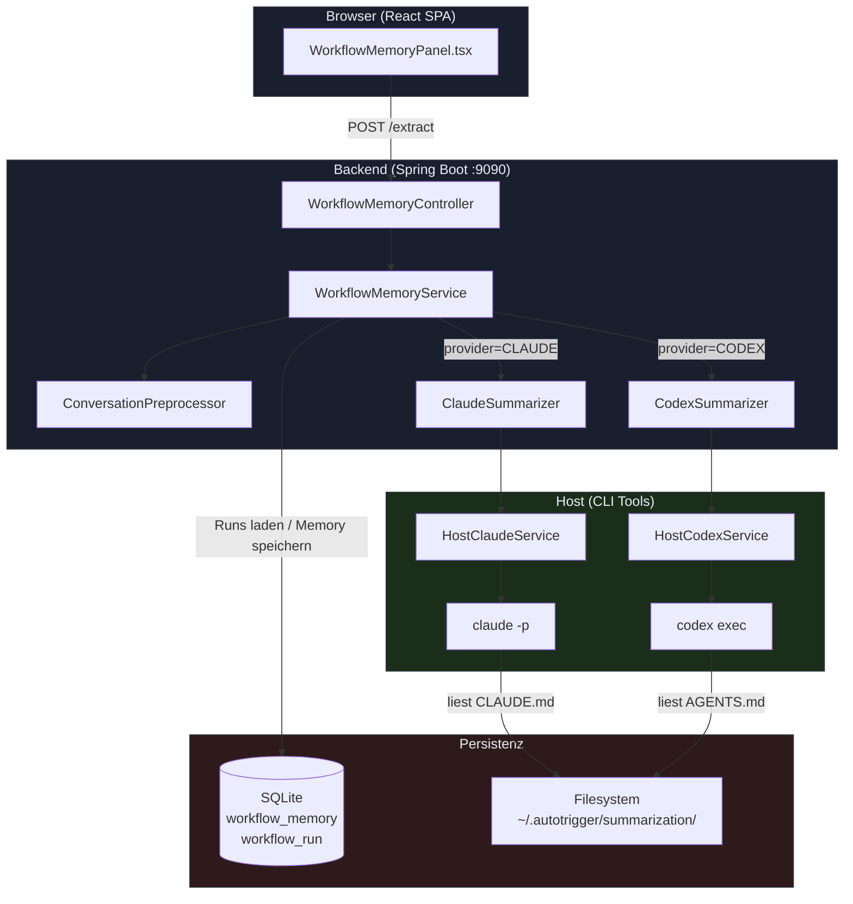
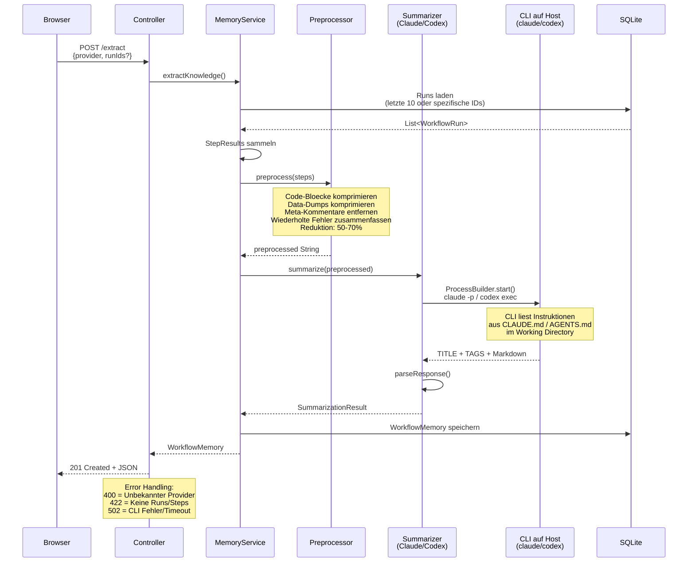
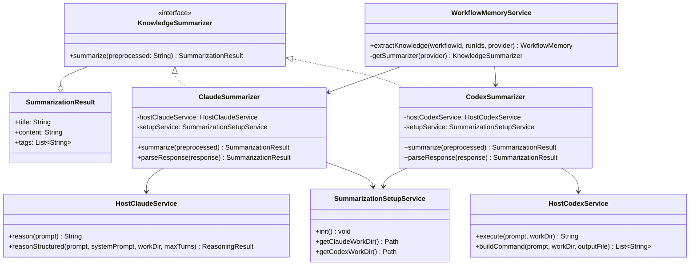
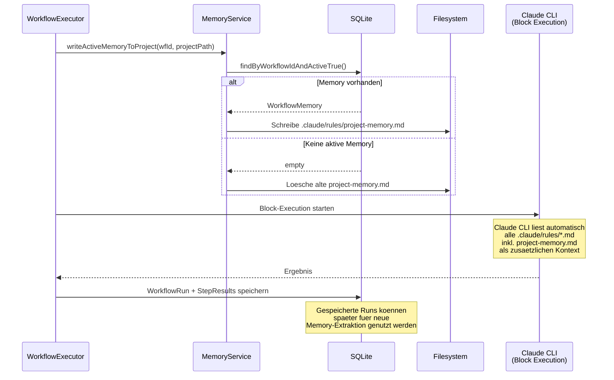
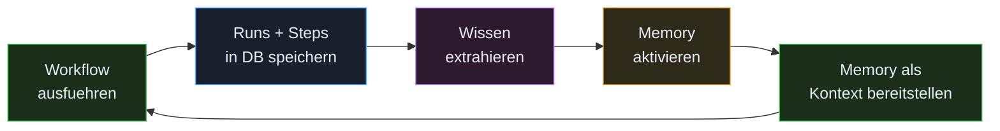
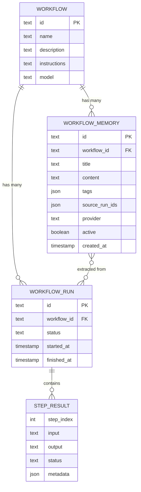
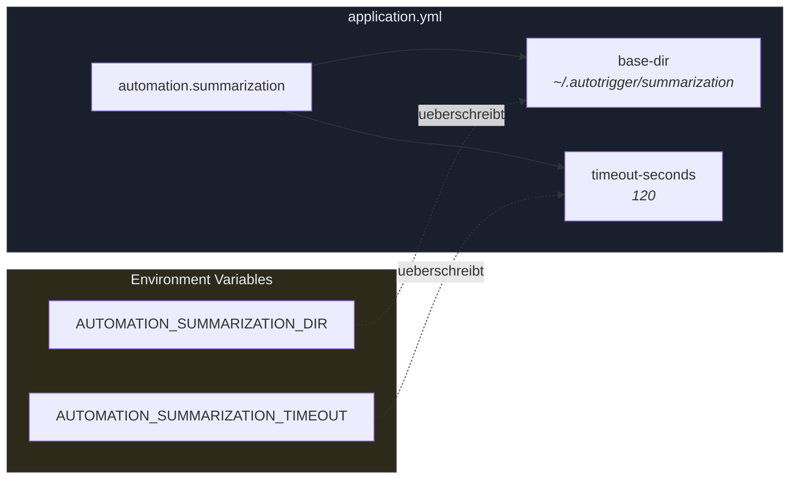

# MySuricates — Workflow Memory

Architektur, Datenfluss & Dateistruktur

## Systemuebersicht — *High-Level Architektur*

Das Workflow Memory Feature extrahiert Wissen aus vergangenen Runs und stellt es bei zukuenftigen Ausfuehrungen als Kontext bereit.



## Datenfluss: Wissen extrahieren — *POST /api/v1/workflows/{id}/memory/extract*

Schritt-fuer-Schritt Ablauf der Wissensextraktion aus Workflow-Runs.



## Summarizer-Architektur — *Provider-Abstraktion*

Beide Provider implementieren dasselbe Interface, nutzen aber unterschiedliche CLIs mit dem gleichen Pattern.



### Provider-Vergleich

| Eigenschaft | ClaudeSummarizer | CodexSummarizer |
|---|---|---|
| CLI-Befehl | `claude -p` | `codex exec` |
| Max Turns | `1` (kein Tool-Use) | Default (exec mode) |
| Output | Stream-JSON parsen | `-o result.txt` |
| Instruktionen | `CLAUDE.md` | `AGENTS.md` |
| Auth | `~/.claude/` | `~/.codex/` |
| API Keys noetig? | Nein (CLI Auth) | Nein (CLI Auth) |

## Datenfluss: Memory bei Workflow-Ausfuehrung — *Feedback-Loop*

Aktivierte Memories werden automatisch in das Projektverzeichnis geschrieben, bevor ein Workflow ausgefuehrt wird.





## Datenmodell — *SQLite Tabellen*

Entity-Relationship-Diagramm der beteiligten Tabellen.



### workflow_memory

`provider`: CLAUDE oder CODEX

`active`: Maximal 1 pro Workflow aktiv

`source_run_ids`: JSON-Array der Run-IDs die zur Extraktion genutzt wurden

`content`: Markdown-formatiertes Wissen

### Beziehungen

Ein Workflow hat viele Runs und viele Memories.

Eine Memory verweist ueber `source_run_ids` auf die Runs, aus denen sie extrahiert wurde.

Beim Aktivieren wird `active=false` fuer alle anderen Memories desselben Workflows gesetzt.

## Dateistruktur — *Projekt + Runtime*

Alle Dateien die zum Workflow Memory Feature gehoeren. `[NEU]` = in diesem Refactoring erstellt, `[ENTFERNT]` = geloescht.

```text
ai-automation-backend/src/main/java/com/automation/
├── config/
│   ├── SummarizationConfig.java          ← Base-Dir + Timeout Config [NEU]
│   ├── HostClaudeConfig.java             ← Timeout fuer Claude CLI (besteht)
│   └── KnowledgeConfig.java              ← OpenAI API-Key Config [ENTFERNT]
│
├── controller/
│   └── WorkflowMemoryController.java     ← REST API, Error Handling 400/422/502
│
├── dto/
│   ├── request/
│   │   └── ExtractMemoryRequest.java     ← {provider, runIds?}
│   └── response/
│       └── WorkflowMemoryResponse.java   ← DTO fuer Frontend
│
├── entity/
│   └── WorkflowMemory.java               ← JPA Entity
│
├── mapper/
│   └── WorkflowMemoryMapper.java         ← MapStruct Entity ↔ DTO
│
├── repository/
│   └── WorkflowMemoryRepository.java     ← Spring Data JPA
│
├── service/ai/
│   ├── HostClaudeService.java            ← +reasonStructured(workDir, maxTurns)
│   └── HostCodexService.java             ← codex exec Wrapper [NEU]
│
└── service/memory/
    ├── KnowledgeSummarizer.java          ← Interface + SummarizationResult
    ├── ClaudeSummarizer.java             ← claude -p, --max-turns 1, Work Dir
    ├── CodexSummarizer.java              ← codex exec, Work Dir [NEU]
    ├── OpenAiSummarizer.java             ← REST + API-Key [ENTFERNT]
    ├── ConversationPreprocessor.java     ← Regelbasierte Kompression
    ├── SummarizationSetupService.java    ← Work Dirs + .md Setup bei Start [NEU]
    └── WorkflowMemoryService.java        ← Orchestrierung, getSummarizer()

ai-automation-backend/src/main/resources/
├── agent-instructions.md                 ← Base Instructions (Block-Execution)
├── application.yml                       ← +summarization.base-dir/timeout
├── db/migration/
│   └── V16__create_workflow_memory_table.sql
└── summarization/                        [NEU]
    ├── claude-summarizer.md              ← Template → CLAUDE.md
    └── codex-summarizer.md               ← Template → AGENTS.md

ai-automation-backend/src/test/java/com/automation/
├── service/ai/
│   ├── HostClaudeServiceTest.java        ← +customMaxTurns Test
│   └── HostCodexServiceTest.java         [NEU]
└── service/memory/
    ├── ClaudeSummarizerTest.java         ← Angepasst an WorkDir
    ├── CodexSummarizerTest.java          [NEU]
    ├── ConversationPreprocessorTest.java
    └── WorkflowMemoryServiceTest.java    ← CodexSummarizer statt OpenAi

ai-automation-frontend/src/
├── components/workflow/
│   └── WorkflowMemoryPanel.tsx           ← Provider: OPENAI → CODEX
├── hooks/
│   └── useWorkflowMemory.ts              ← TanStack Query Hooks
└── types/
    └── index.ts                          ← WorkflowMemory, ExtractMemoryRequest

~/.autotrigger/summarization/             ← Runtime (erstellt bei Backend-Start)
├── claude/
│   └── CLAUDE.md                         ← Kopie von claude-summarizer.md
└── codex/
    └── AGENTS.md                         ← Kopie von codex-summarizer.md

docs/
└── workflow-memory-architecture.md       [NEU]
```

## API-Endpunkte — */api/v1/workflows/{id}/memory*

| Methode | Pfad | Beschreibung | Response |
|---|---|---|---|
| `GET` | `/memory` | Alle Memories eines Workflows | `200` List<WorkflowMemoryResponse> |
| `POST` | `/memory/extract` | Wissen extrahieren (~30-60s) | `201` / `400` / `422` / `502` |
| `PUT` | `/memory/{memId}` | Title/Content aktualisieren | `200` WorkflowMemoryResponse |
| `PUT` | `/memory/{memId}/activate` | Memory aktivieren (deaktiviert andere) | `200` |
| `DELETE` | `/memory/{memId}` | Memory loeschen | `204` |

### Error Responses (POST /extract)

| Status | Ursache | Body |
|---|---|---|
| `400` | Unbekannter Provider | `{"error": "Unknown provider: X"}` |
| `422` | Keine Runs oder Steps | `{"error": "No runs found..."}` |
| `502` | CLI Timeout / Crash | `{"error": "Knowledge extraction failed: ..."}` |

## Konfiguration — *application.yml*



### Voraussetzungen

- `claude` CLI installiert und authentifiziert (`~/.claude/`)
- `codex` CLI installiert und authentifiziert (`~/.codex/`)
- Keine API-Keys in der App-Konfiguration noetig

### Startup

- `SummarizationSetupService.init()` laeuft bei Backend-Start
- Erstellt Working Directories falls nicht vorhanden
- Kopiert Instruktions-Templates aus Resources in die Directories
- Ueberschreibt bei jedem Start (latest bundled version)
