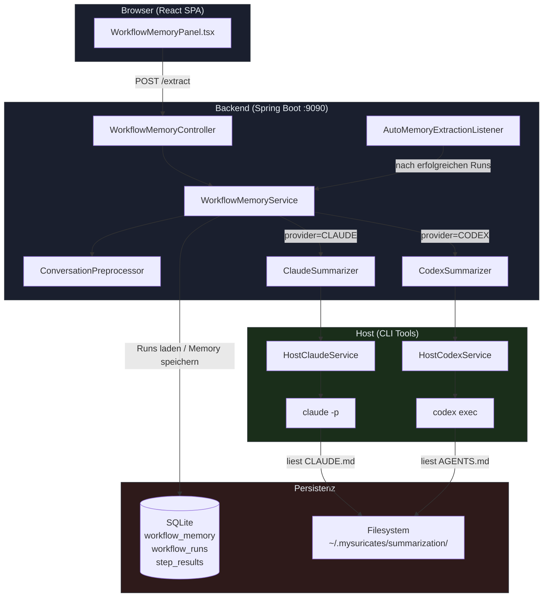
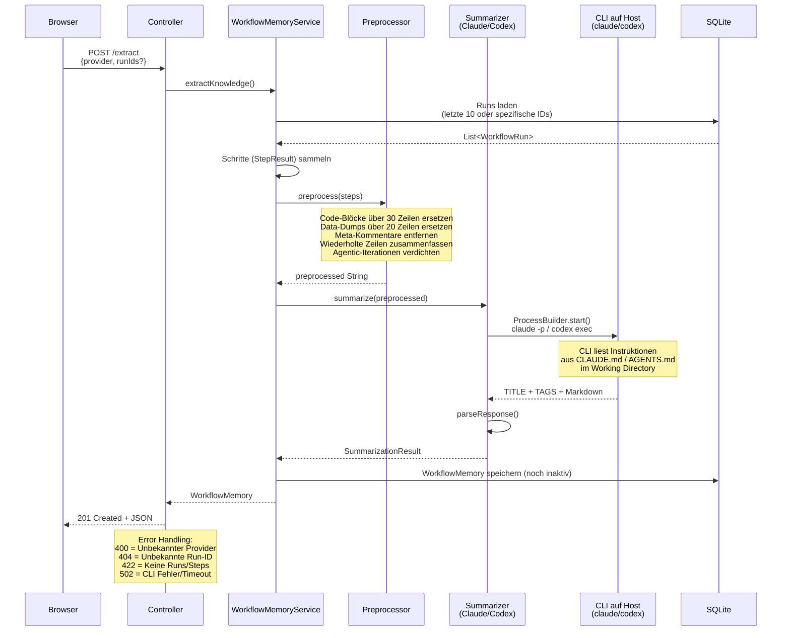
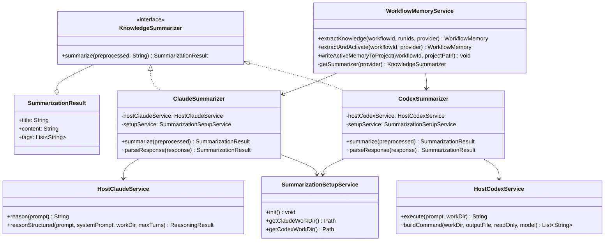
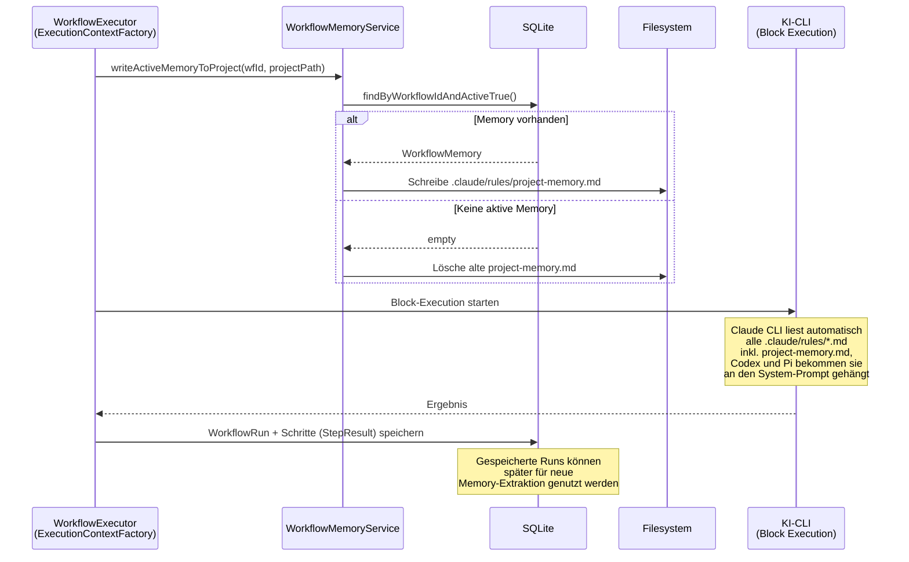
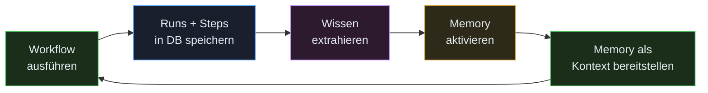
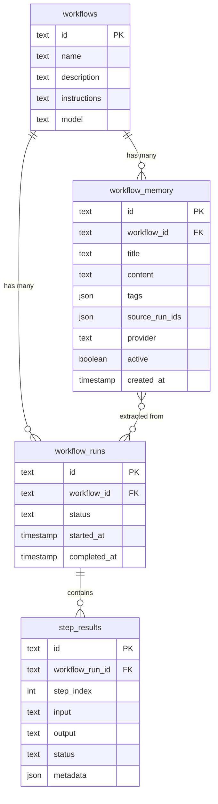
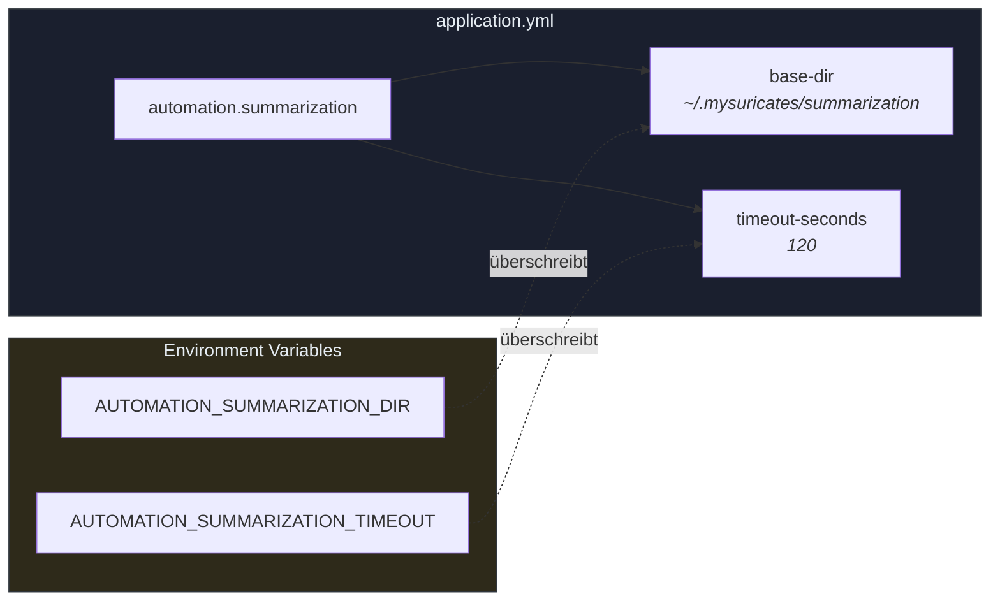

# MySuricates — Workflow Memory

Architektur, Datenfluss & Dateistruktur

## Systemübersicht — *High-Level Architektur*

Workflow Memory extrahiert Wissen aus vergangenen Runs und stellt es späteren Ausführungen als Kontext bereit. Es ist ein optionales Modul (`memory`, in den Presets `research` und `full`).



## Datenfluss: Wissen extrahieren — *POST /api/v1/workflows/{id}/memory/extract*

Schritt für Schritt: Runs lesen, verdichten, zusammenfassen, speichern. Der KI-Aufruf läuft außerhalb jeder Transaktion — zwischen einem kurzen Lese- und einem kurzen Schreibvorgang, weil die Datenbank nur eine Verbindung hat.



## Summarizer-Architektur — *Provider-Abstraktion*

Beide Provider implementieren dasselbe Interface, nutzen aber unterschiedliche CLIs mit dem gleichen Pattern.



### Provider-Vergleich

| Eigenschaft | ClaudeSummarizer | CodexSummarizer |
|---|---|---|
| CLI-Befehl | `claude -p` | `codex exec` (Prompt über stdin) |
| Max Turns | `1` (kein Tool-Use) | Default (exec mode) |
| Output | Stream-JSON parsen | `-o` in eine temporäre Datei |
| Instruktionen | `CLAUDE.md` | `AGENTS.md` |
| Timeout | `automation.host-claude.timeout-seconds` | `automation.summarization.timeout-seconds` |
| Auth | `~/.claude/` | `~/.codex/` |
| API Keys nötig? | Nein (CLI Auth) | Nein (CLI Auth) |

## Datenfluss: Memory bei Workflow-Ausführung — *Feedback-Loop*

Die aktive Memory eines Workflows schreibt der Run vor dem ersten Block in das Projektverzeichnis.





Automatisch: Mit `autoMemoryExtraction` in den Workflow-Metadaten (optional mit `interval`, Standard 5) extrahiert der `AutoMemoryExtractionListener` nach einem Run mit `COMPLETED`, sobald seit der letzten Memory so viele Runs erfolgreich waren, per Claude eine neue Memory, aktiviert sie und schreibt sie ins Projekt.

## Datenmodell — *SQLite Tabellen*

Entity-Relationship-Diagramm der beteiligten Tabellen.



### workflow_memory

`provider`: CLAUDE oder CODEX

`active`: Maximal 1 pro Workflow aktiv

`source_run_ids`: JSON-Array der Run-IDs, die zur Extraktion genutzt wurden

`content`: Markdown-formatiertes Wissen

### Beziehungen

Ein Workflow hat viele Runs und viele Memories.

Eine Memory verweist über `source_run_ids` auf die Runs, aus denen sie extrahiert wurde.

Beim Aktivieren wird `active=false` für alle anderen Memories desselben Workflows gesetzt.

## Dateistruktur — *Projekt + Runtime*

Die wichtigsten Dateien des Workflow-Memory-Features. Tests liegen unter `ai-automation-backend/src/test/java/com/automation/`, meist im Paket der getesteten Klasse.

```text
ai-automation-backend/src/main/java/com/automation/
├── config/
│   ├── SummarizationConfig.java          ← base-dir + Timeout (automation.summarization)
│   └── HostClaudeConfig.java             ← Timeout der Claude-CLI
│
├── controller/
│   └── WorkflowMemoryController.java     ← REST-API, Fehler 400/422/502
│
├── dto/
│   ├── request/
│   │   ├── ExtractMemoryRequest.java     ← {provider, runIds?}
│   │   └── UpdateMemoryRequest.java      ← {title, content}
│   └── response/
│       └── WorkflowMemoryResponse.java
│
├── entity/
│   └── WorkflowMemory.java               ← JPA-Entity
│
├── mapper/
│   └── WorkflowMemoryMapper.java         ← MapStruct Entity ↔ DTO
│
├── repository/
│   └── WorkflowMemoryRepository.java     ← Spring Data JPA
│
├── service/ai/
│   ├── HostClaudeService.java            ← reasonStructured(…, workDir, maxTurns)
│   ├── HostCodexService.java             ← Hülle um codex exec
│   └── RunContextFiles.java              ← .claude/rules/project-memory.md, für Codex/Pi angehängt
│
└── service/memory/
    ├── KnowledgeSummarizer.java          ← Interface + SummarizationResult
    ├── ClaudeSummarizer.java             ← claude -p, --max-turns 1, Arbeitsverzeichnis
    ├── CodexSummarizer.java              ← codex exec, Arbeitsverzeichnis
    ├── ConversationPreprocessor.java     ← regelbasierte Verdichtung
    ├── SummarizationSetupService.java    ← Arbeitsverzeichnisse + CLAUDE.md/AGENTS.md beim Start
    ├── AutoMemoryExtractionListener.java ← automatische Extraktion nach erfolgreichen Runs
    └── WorkflowMemoryService.java        ← Ablaufsteuerung, getSummarizer(), writeActiveMemoryToProject()

ai-automation-backend/src/main/resources/
├── agent-instructions.md                 ← Basis-Anweisungen (Block-Ausführung)
├── application.yml                       ← automation.summarization.base-dir / timeout-seconds
├── db/migration/
│   └── V16__create_workflow_memory_table.sql
└── summarization/
    ├── claude-summarizer.md              ← Vorlage → CLAUDE.md
    └── codex-summarizer.md               ← Vorlage → AGENTS.md

ai-automation-frontend/src/
├── components/workflow/
│   └── WorkflowMemoryPanel.tsx           ← Anbieter CLAUDE oder CODEX
├── hooks/
│   └── useWorkflowMemory.ts              ← TanStack-Query-Hooks
└── types/
    └── index.ts                          ← WorkflowMemory, ExtractMemoryRequest

~/.mysuricates/summarization/             ← Laufzeit (beim Backend-Start angelegt)
├── claude/
│   └── CLAUDE.md                         ← Kopie von claude-summarizer.md
└── codex/
    └── AGENTS.md                         ← Kopie von codex-summarizer.md
```

## API-Endpunkte — */api/v1/workflows/{id}/memory*

| Methode | Pfad | Beschreibung | Response |
|---|---|---|---|
| `GET` | `/memory` | Alle Memories eines Workflows, neueste zuerst | `200` `List<WorkflowMemoryResponse>` |
| `POST` | `/memory/extract` | Wissen extrahieren (ohne `provider`: CLAUDE) | `201` / `400` / `404` / `422` / `502` |
| `PUT` | `/memory/{memId}` | Title/Content aktualisieren | `200` `WorkflowMemoryResponse` |
| `PUT` | `/memory/{memId}/activate` | Memory aktivieren (deaktiviert andere) | `204` |
| `DELETE` | `/memory/{memId}` | Memory löschen | `204` |

### Error Responses (POST /extract)

| Status | Ursache | Body |
|---|---|---|
| `400` | Unbekannter Provider | `{"error": "Unknown provider: X. Available: [CLAUDE, CODEX]"}` |
| `404` | Unbekannte Run-ID in `runIds` | `{"code": "RESOURCE_NOT_FOUND", ...}` |
| `422` | Keine Runs oder Steps | `{"error": "No runs found..."}` |
| `502` | CLI Timeout / Crash | `{"error": "Knowledge extraction failed: ..."}` |

## Konfiguration — *application.yml*



`timeout-seconds` begrenzt den Codex-Aufruf und lässt sich zur Laufzeit in den Einstellungen ändern (`summarization-timeout-seconds`); der Claude-Aufruf folgt `automation.host-claude.timeout-seconds`.

### Voraussetzungen

- Für den Provider CLAUDE: `claude` CLI installiert und angemeldet (`~/.claude/`)
- Für den Provider CODEX: `codex` CLI installiert und angemeldet (`~/.codex/`)
- Keine API-Keys in der App-Konfiguration nötig

### Startup

- `SummarizationSetupService.init()` läuft bei Backend-Start
- Erstellt Working Directories falls nicht vorhanden
- Kopiert Instruktions-Templates aus Resources in die Directories
- Überschreibt bei jedem Start (latest bundled version)
